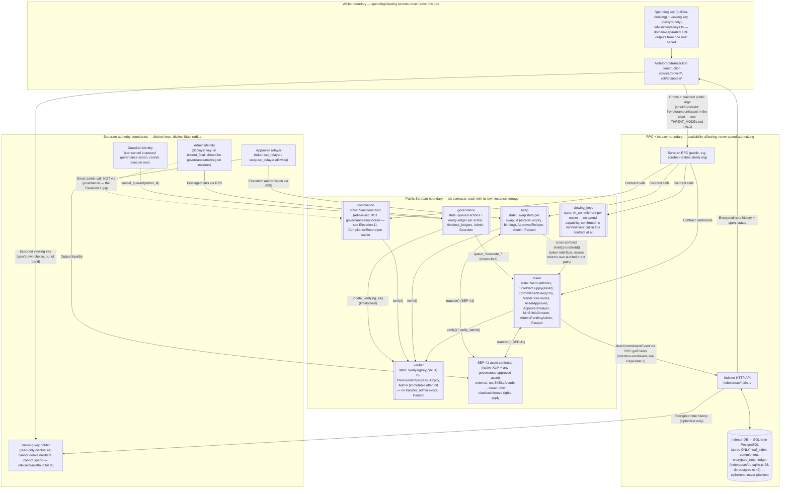

# ZKELLA Data Flows and Trust Boundaries

Produced 2026-11-13, extending the data-flow diagram first drafted in `docs/EXTERNAL_AUDIT_PREPARATION.md` with explicit state stores and the trust-boundary detail `docs/audit/THREAT_MODEL.md`'s threat table maps against. Entities and crossings below were checked against the current contract/SDK/indexer source, not just the diagram.

## Entities and what crosses each boundary

| Entity | What it can affect | What it cannot affect |
|---|---|---|
| **Wallet** | Constructs everything that leaves it; holds the only copy of the spending key. | Cannot be impersonated without the spending key (Spoof.1) — see THREAT_MODEL.md. |
| **Soroban RPC** | Availability of reads/writes; can be slow, down, or (if a specific provider is malicious) lie about simulation results before a real submission — but cannot forge a valid signature or proof. | Cannot authorize a spend or alter accepted on-chain state once a transaction lands. |
| **Indexer** | Availability and completeness of note-recovery for whoever relies on it (Repudiate.2, still open). Stores ciphertext/commitments only — confirmed via `indexer/src/db-sqlite.ts:26`, `db-postgres.ts:42`. | Cannot decrypt note contents (no key material held), cannot forge a spend, cannot alter on-chain state. |
| **Relayer** | Receives a transfer fee or fronts swap output liquidity; decouples the fee-payer identity from the note owner for `transfer`/`transfer4` only. | Cannot redirect swap output (Spoof.3, closed by binding-tag design) or spend a note it doesn't own. |
| **Admin identity** | Every admin-gated entrypoint across all six contracts. On `testnet_final`, this is a bare deployer key for `compliance`/`swap`, and `governance`'s contract address for `token`/`verifier` (per `deployments.json`). | Cannot repoint `verifier`'s admin at all (no such function exists) or `token`'s admin in practice (no governance action calls it) — Elevation.2. |
| **Guardian identity** | Can cancel a queued governance action before it executes. | Cannot execute an action itself, cannot bypass the timelock to act immediately. |
| **Viewing-key holder** | Can decrypt every note the holder's wallet can reach, back to `birthday_ledger`, forward until revoked (and retroactively for anything already decrypted — Info.2). | Cannot derive nullifiers, cannot spend, cannot detect spends (receipts only). |
| **SEP-41 asset issuer** (for a non-native approved asset) | Retains whatever clawback/freeze rights the underlying Stellar Asset Contract grants, including against `token`'s own custodied balance after a deposit — `contracts/token/src/lib.rs:211-225`'s own doc comment calls this "a deliberate acceptance of that issuer's clawback risk." | Has no visibility into or control over note contents, nullifiers, or the shielded pool's internal accounting beyond the balance it can claw back. |

## State stores, explicitly

1. **Contract instance/persistent storage** (six separate contracts, listed in the diagram above) — the only state that determines spendability, supply, and authorization. Subject to Soroban's TTL/archival mechanics; see THREAT_MODEL.md DoS.3 for why this doesn't currently lapse unexpectedly.
2. **Indexer database** (SQLite or PostgreSQL) — a derived, rebuildable cache of on-chain events, holding ciphertext and commitments only. Losing it loses convenience, not funds or secrets — a wallet can in principle re-scan on-chain events directly (Repudiate.2's open question is about whether that fallback actually exists in the SDK today, not whether it's theoretically possible).
3. **Wallet-local storage** (outside this repo's control — however the SDK's consumer persists keys) — the only place spending-key material exists. Not inventoried further here since it's consumer-defined, not part of ZKELLA's own codebase.
